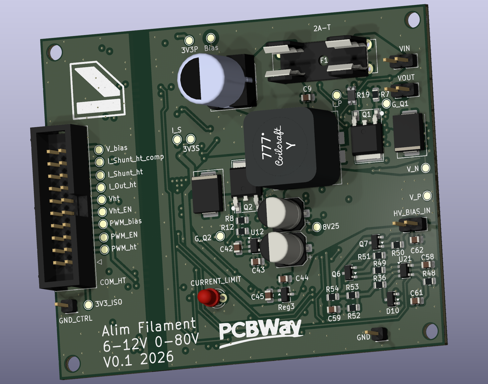
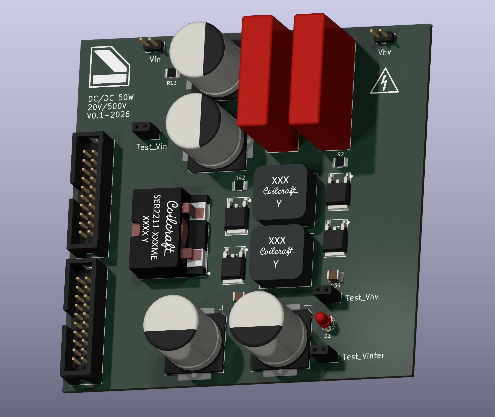
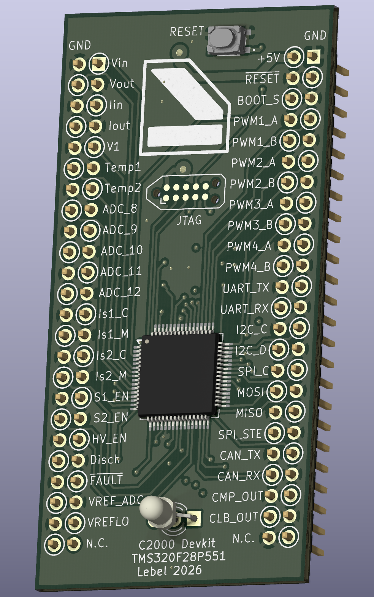
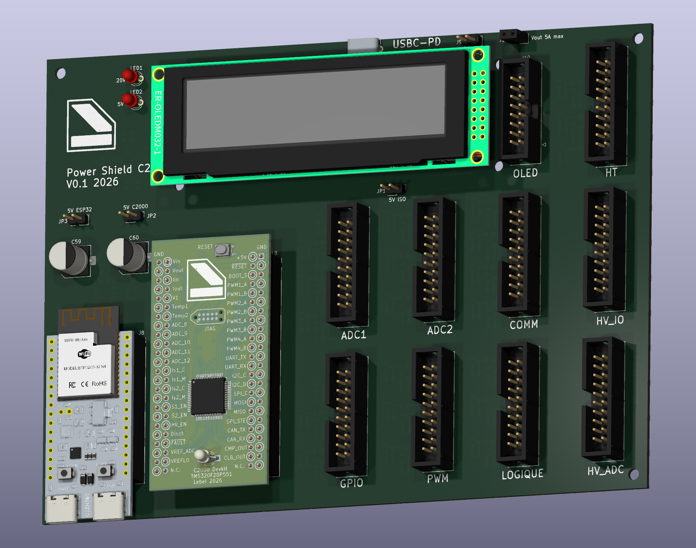

# Nicolas Boyer

Électronique de puissance, embarqué, et ce qui va avec — de la lecture de
datasheet au routage, du registre au modèle de langage.

Les dépôts ci-dessous sont des projets réels, dans l'état où ils sont. Ce qui
ne fonctionne pas encore y est écrit.

---

## Deux systèmes complets

### Alimentation haute tension pour préamplis à tubes

Quatre dépôts, une seule chaîne : les deux cartes de puissance, le firmware
qui les régule, et le superviseur qui les pilote.

| | |
|---|---|
| [**KICAD-C2000-float-flyback**](https://github.com/Nicolboy/KICAD-C2000-float-flyback) | alimentation filaments (HT), carte KiCad 10 |
| [**KICAD-C2000-devkit**](https://github.com/Nicolboy/KICAD-C2000-devkit) | shield d'isolation et cartes devkit, KiCad 10 |
| [**CCS-C2000-hv-boost**](https://github.com/Nicolboy/CCS-C2000-hv-boost) | firmware TMS320F28027 — deux étages boost, 10 V → 500 V |
| [**VSCODE-ESP32-hv-boost**](https://github.com/Nicolboy/VSCODE-ESP32-hv-boost) | ESP32-C3 — pont série, IHM OLED, API HTTP |

Deux étages de tension, deux logiques différentes.

**Chauffage** : un étage abaisseur (buck), dont la tension de polarisation
permet d'élever le secondaire flottant jusqu'à 80 V.

**Tension d'anode** : deux étages élévateurs (boost) en cascade, 200 kHz
puis 100 kHz, 10 V → 500 V. La protection est **matérielle et locale** :
comparateurs analogiques et Trip Zone, environ 30 ns. Le superviseur propose
des consignes, il n'a aucune autorité de sécurité.

Le devkit est dessiné pour deux microcontrôleurs différents — F280037 et
F28P551 — avec un connecteur **identique à 100 %**. Son brochage est décrit
en Markdown, les symboles KiCad en sont générés : les règles de conception
deviennent exécutables au lieu d'être seulement écrites.

Une carte d'alimentation porte le devkit ESP32 et un écran OLED, et fait la
liaison vers les cartes filles de conversion à découpage. Visualisation et
paramétrage se font via une page HTML accessible en Wi-Fi et Bluetooth.

### WireClaw — drone d'inspection piloté en langage naturel

| | |
|---|---|
| [**VSCODE-JETSON-wireclaw**](https://github.com/Nicolboy/VSCODE-JETSON-wireclaw) | station sol Jetson Orin Nano — LLM → MAVLink, inférence YOLOv8 |
| [**VSCODE-PIZERO-wireclaw**](https://github.com/Nicolboy/VSCODE-PIZERO-wireclaw) | Pi Zero 2W embarqué — caméra OV5647, H.264 en RTP/UDP |

Un opérateur donne ses instructions en français, à l'écrit ou à l'oral ; un
modèle de langage les interprète et produit les commandes MAVLink vers
ArduPilot. La liaison vidéo passe par wifibroadcast longue portée, décodée au
sol sous GStreamer avec détection annotée en temps réel.

---

## Un portage entre deux architectures

| | |
|---|---|
| [**CCS-MSP430-pwl**](https://github.com/Nicolboy/CCS-MSP430-pwl) | alimentation fantôme 48 V sur batterie, MSP430G2252 |
| [**CCS-MSPM0-pwl**](https://github.com/Nicolboy/CCS-MSPM0-pwl) | le même, porté sur MSPM0C1104 — Cortex-M0+ |

Élévation vers 48 V par DC/DC polyphasé sur un microcontrôleur à 20 broches,
avec **auto-étalonnage sauvegardé en flash** : plutôt que de figer un rapport
cyclique calculé, chaque carte se règle sur ses propres composants sous charge
connue. Ce qui dispense de trier les inductances.

Le dépôt MSPM0 garde le journal du portage, périphérique par périphérique, dans
l'ordre où ils ont été franchis.

---

## Ce que je fais

**Conception électronique** — lecture et interprétation de schémas, choix de
composants sur datasheet, analogique et numérique. Chaînes de mesure de
courant, conditionnement, références de tension, protections.

**PCB** — conception et routage sous KiCad, du symbole au Gerber. Contraintes
de fabrication assumées : les projets existent en variante 2 couches gravée à
la maison pour itérer vite, et 4 couches en fabrication externe pour les plans
de masse continus.

**Conversion d'énergie** — boost, polyphasé, soft start, régulation numérique,
protections matérielles à déclenchement rapide. De quelques milliampères sous
48 V à 500 V sur batterie.

**Embarqué** — C sur MSP430, MSPM0, C2000, ESP32 ; Python sur Linux embarqué.
Écriture directe de registres quand la couche d'abstraction coûte trop cher, et
étalonnage fondé sur la mesure plutôt que sur le calcul.

**IA appliquée** — inférence embarquée sur Jetson, interprétation d'instructions
en langage naturel vers des commandes machine. Et l'usage d'agents dans la
conception matérielle elle-même : lecture de documentation technique, génération
de symboles, vérifications exécutables.

---

## Outils

| Domaine | |
|---|---|
| Électronique | **KiCad 10**, kicad-cli, API kipy |
| Microcontrôleurs TI | **Code Composer Studio**, C2000Ware, MSPM0 SDK, SysConfig |
| ESP32 | **ESP-IDF**, PlatformIO |
| Linux embarqué | **VS Code**, GStreamer, MAVLink/ArduPilot, YOLOv8 |
| Général | C, Python, C++, git, Claude Code |

---

## Une façon de travailler

Une part du travail est faite avec un agent : lecture de datasheets, extraction
des contraintes, rédaction des spécifications, génération de symboles, pose des
composants. **Le placement et le routage restent manuels** — ils encodent des
choix qu'aucun script ne devine sur une chaîne de mesure de courant.

C'est documenté, avec les pièges rencontrés et leur signature, dans
[methode-kicad-claude.md](https://github.com/Nicolboy/KICAD-C2000-devkit/blob/main/doc/methode-kicad-claude.md).

---

contact@nicolasboyer.fr
