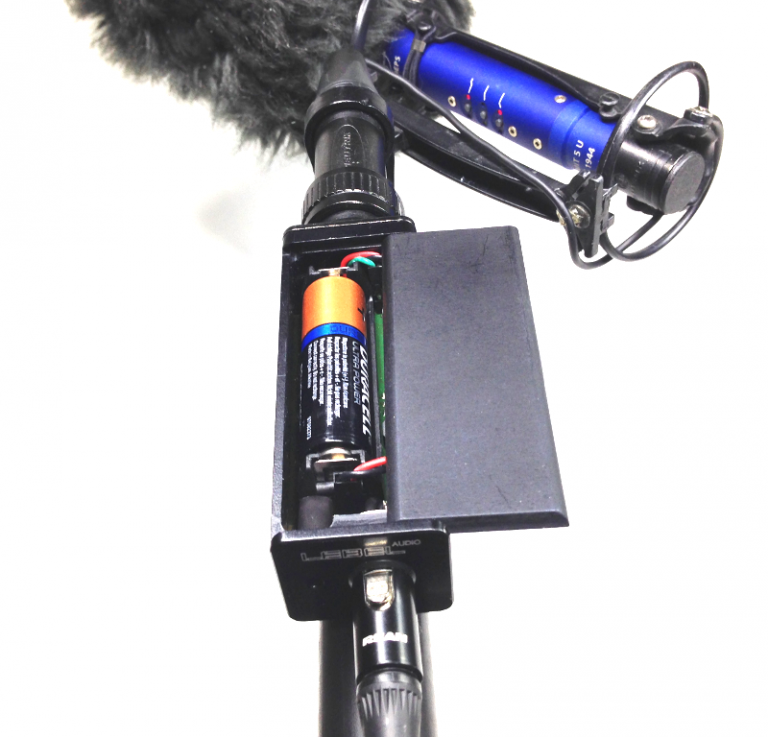
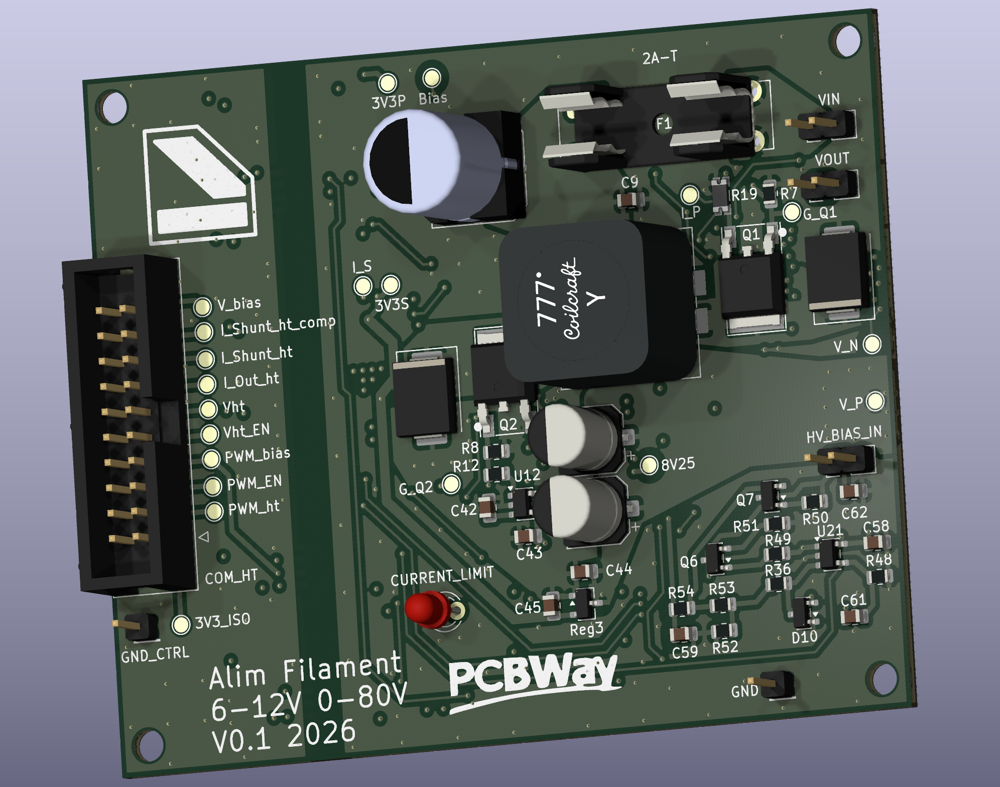
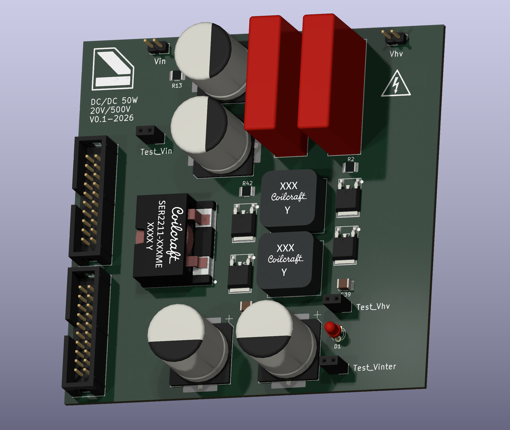
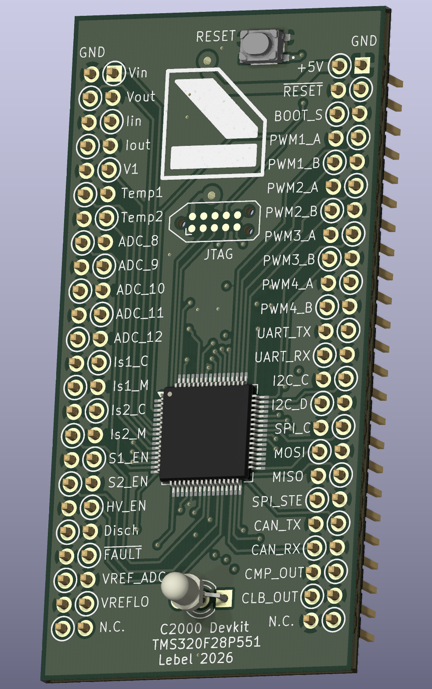
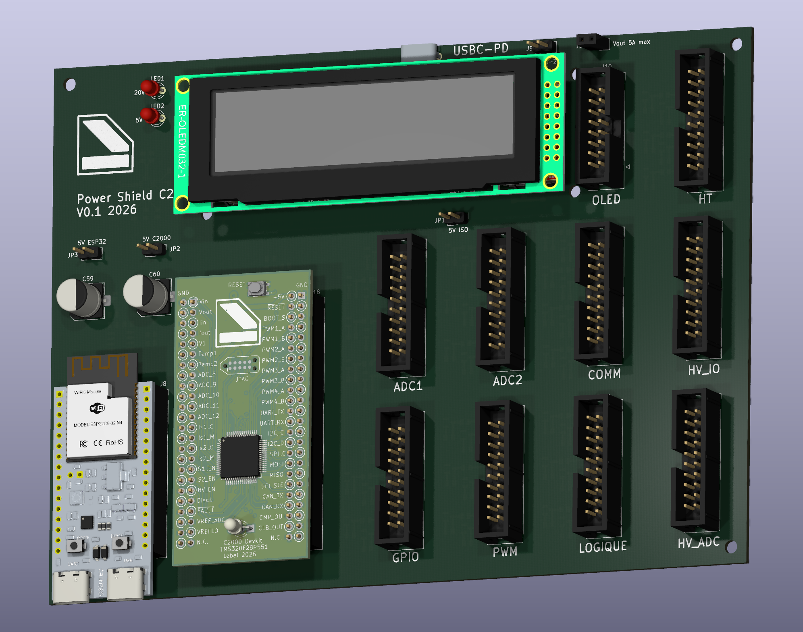
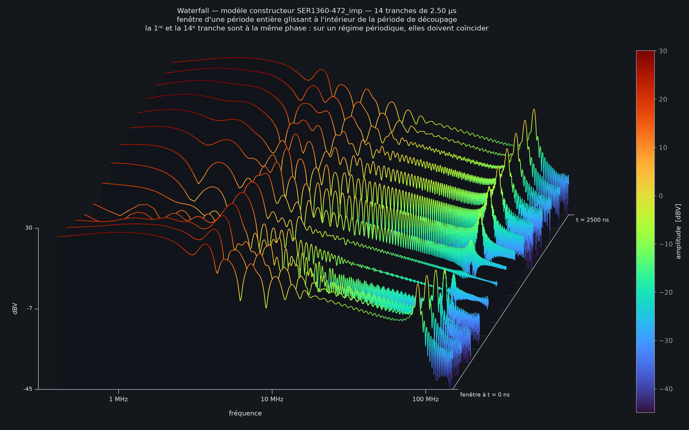
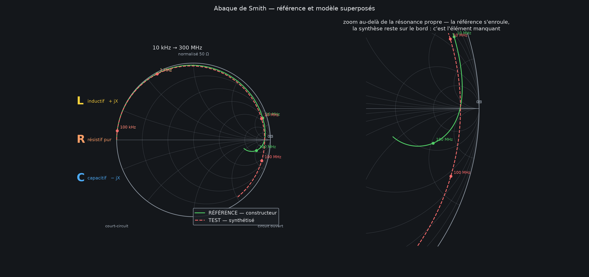

# Nicolas Boyer

Power electronics and embedded systems — from SPICE model to routed board,
from register-level firmware to LLM-driven agents in the hardware design
loop itself.

- **11–25V → 500V** — dual-stage boost HV supply, hardware trip-zone
  protection: 30 ns comparator, qualified to ~0.5 µs on measurement to
  reject switching spikes, fully independent from the controlling MCU
- **91.7% measured at 50W** — stage 1 on real hardware (VSCODE-ESP32-hv-boost);
  97.1% simulated at 47W for the next iteration (GaN, vendor models
  checked against their own datasheets to 0.5%, losses closed to 1.7%)
- **100% identical connector (56/56)** across two different C2000 MCU
  packages in KICAD-C2000-devkit, generated from a single Markdown pin
  spec rather than hand-drawn in KiCad — later abandoned on the
  powershield carrier once the two devkits needed different connectors
- Natural-language drone control: a Jetson-hosted LLM turns French
  voice/text instructions into MAVLink commands, with real-time YOLOv8
  detection over a long-range video downlink

---

## Ce que je fais

**Conception électronique** — lecture et interprétation de schémas, choix de
composants sur datasheet, analogique et numérique. Chaînes de mesure de
courant, conditionnement, références de tension, protections.

**PCB** — conception et routage sous KiCad, du symbole au Gerber. Contraintes
de fabrication assumées : les projets existent en variante 2 couches gravée à
la maison pour itérer vite, et 4 couches en fabrication externe pour les plans
de masse continus.

**Conversion d'énergie** — boost, polyphasé, soft start, régulation numérique,
protections matérielles à déclenchement rapide. De quelques milliampères sous
48 V à 500 V sur batterie.

**Simulation** — SPICE en lot (LTspice, ngspice) piloté depuis Python, sur
**modèles constructeur** plutôt que sur composants idéaux. Extraction et
contrôle des grandeurs qui décident d'un dimensionnement — Coss, Qoss, Eoss,
Rds(Tj) — contre les courbes du datasheet avant de s'en servir. Bilan de
pertes sommé sur les seuls éléments dissipatifs, facteur de qualité mesuré
par sonnerie libre, contenu spectral par FFT, FFT court terme et waterfall.
La règle qui tient le reste : **un simulateur rend un fichier de résultats
lisible même quand le calcul a échoué**, donc rien n'est dépouillé sans
avoir été refusé d'abord.

**Embarqué** — C sur MSP430, MSPM0, C2000, ESP32 ; Python sur Linux embarqué.
Écriture directe de registres quand la couche d'abstraction coûte trop cher, et
étalonnage fondé sur la mesure plutôt que sur le calcul.

**IA appliquée** — inférence embarquée sur Jetson, interprétation d'instructions
en langage naturel vers des commandes machine. Et l'usage d'agents dans la
conception matérielle elle-même : lecture de documentation technique, génération
de symboles, vérifications exécutables.

---

Électronique de puissance, embarqué, et ce qui va avec — de la lecture de
datasheet au routage, du registre au modèle de langage.

Les dépôts ci-dessous sont des projets réels, dans l'état où ils sont. Ce qui
ne fonctionne pas encore y est écrit.

---

## Deux projets en cours de réalisation

### Alimentation haute tension pour préamplis à tubes

Six dépôts, une seule chaîne : les deux cartes de puissance, la carte de
contrôle, la carte d'alimentation, le firmware qui régule, et le
superviseur qui pilote.

| | |
|---|---|
| [**KICAD-C2000-float-flyback**](https://github.com/Nicolboy/KICAD-C2000-float-flyback) | alimentation filaments (HT), carte KiCad 10 |
| **KICAD-HV** | alimentation tension d'anode (200–500 V, boost double étage), carte KiCad 10 — dépôt non public |
| [**KICAD-C2000-devkit**](https://github.com/Nicolboy/KICAD-C2000-devkit) | shield d'isolation et cartes devkit, KiCad 10 |
| [**KICAD-C2000-powershield**](https://github.com/Nicolboy/KICAD-C2000-powershield) | carte d'alimentation USB-C PD, liaison devkit/cartes filles, KiCad 10 |
| [**CCS-C2000-hv-boost**](https://github.com/Nicolboy/CCS-C2000-hv-boost) | firmware TMS320F28027 — deux étages boost, 11–25 V → 500 V |
| [**VSCODE-ESP32-hv-boost**](https://github.com/Nicolboy/VSCODE-ESP32-hv-boost) | ESP32-C3 — pont série, IHM OLED, API HTTP — étage 1 testé, **91,7 % mesuré à 50 W** |

Deux étages de tension, deux logiques différentes.

**Chauffage** : une alimentation flyback, filament 6 à 12 V, dont la
référence flottante peut être élevée de 0 à 90 V DC au-dessus de 0 V pour
réduire le stress cathode/chauffage.

**Tension d'anode** : deux étages élévateurs (boost) en cascade, 200 kHz
puis 100 kHz, permettent d'obtenir entre 200 V et 500 V à partir d'une
tension d'alimentation entre 11 V et 25 V. La protection est **matérielle
et locale** via une logique rapide dédiée : comparateurs analogiques et
Trip Zone, 30 ns pour le comparateur seul, qualifiés à environ 0,5 µs sur
mesure pour ignorer les pointes de commutation.

**Carte de contrôle** : cette carte de contrôle PWM/ADC est dessinée pour
deux microcontrôleurs différents — F280037 et F28P551 — avec un connecteur
**identique à 100 % (56/56 broches)** dans KICAD-C2000-devkit. Son brochage
est décrit en Markdown, les symboles KiCad en sont générés : les règles de
conception deviennent exécutables au lieu d'être seulement écrites. Sur la
carte d'alimentation qui a succédé au shield (KICAD-C2000-powershield), le
connecteur du devkit F28P551 a changé (décision #25) : les deux devkits ne
sont plus interchangeables sur ce shield-là. La boucle de régulation est
intégralement logicielle, dans le firmware de ces microcontrôleurs de la
famille C2000 Texas Instruments, spécialisés dans la conversion d'énergie.

**Carte d'alimentation** : cette carte utilise une source d'alimentation
USB-C Power Delivery contrôlée de 100 W. Elle permet de connecter les
cartes filles de conversion à découpage au microcontrôleur et de les
alimenter. Elle porte aussi la carte ESP32 et un écran OLED pour la
visualisation et le paramétrage. Une page HTML accessible via hotspot
Wi-Fi permet de contrôler les tensions et de visualiser les états et
paramètres des cartes filles.

### WireClaw — drone d'inspection piloté en langage naturel

| | |
|---|---|
| [**VSCODE-JETSON-wireclaw**](https://github.com/Nicolboy/VSCODE-JETSON-wireclaw) | station sol Jetson Orin Nano — LLM → MAVLink, inférence YOLOv8 |
| [**VSCODE-PIZERO-wireclaw**](https://github.com/Nicolboy/VSCODE-PIZERO-wireclaw) | Pi Zero 2W embarqué — caméra OV5647, H.264 en RTP/UDP |

Un opérateur donne ses instructions en français, à l'écrit ou à l'oral ; un
modèle de langage les interprète et produit les commandes MAVLink vers
ArduPilot. La liaison vidéo passe par wifibroadcast longue portée, décodée au
sol sous GStreamer avec détection annotée en temps réel.

---

## Le dimensionnement, avant la carte

| | |
|---|---|
| [**LTSPICE-boost**](https://github.com/Nicolboy/LTSPICE-boost) | premier étage de la chaîne HV : boost 11–25 V → 50–100 V, 50 W — LTspice et ngspice pilotés en Python |

L'étude amont du premier étage de la carte HV ci-dessus, écrite comme un
cahier : chaque chapitre pose une question, la tranche sur des mesures, et
**garde la trace de ce qui s'est révélé faux**. Fréquence et inductance,
puis calibre et technologie du transistor, puis l'arbitrage d'architecture
— conduction continue ou discontinue —, puis l'EMI conduite.

**Les modèles constructeur sont vérifiés avant d'être utilisés.** Coss, Qoss,
Eoss et Rds(Tj) sont extraits sur banc d'injection de courant et confrontés
aux courbes du datasheet — écarts de 0,1 à 0,5 %. Sans ce contrôle, une
estimation par loi de puissance se trompait de 25 à 40 % sur Eoss, et un
relevé de pente à l'œil sur une courbe de datasheet d'un facteur 1,8.

**Les pertes sont sommées sur les éléments dissipatifs**, jamais par la
puissance aux bornes d'un composant : celle-ci inclut le stockage capacitif,
réversible, dont l'intégration numérique laisse un résidu. Seule la première
méthode converge quand on divise le pas de temps. Bilan bouclé à 1,7 %,
**97,06 % à 47,4 W**.

**Et ce qui ne marche pas y est écrit.** Une inductance idéale porte un
facteur de qualité de 6 567 là où le modèle constructeur en rend 16 : la
sonnerie qu'on voyait sur les oscillogrammes venait du modèle, pas du
circuit. Un chiffre de résonance propre entré dans un tableau de choix de
composant venait d'un fichier reconstruit à la main — il a été retiré.

**Un modèle se contrôle avant de s'en servir.** Un banc d'impédance confronte
tout modèle de composant passif à une référence — modèle constructeur, courbe
de datasheet, paramètres S — sur le module, la phase, l'écart en dB et
l'abaque de Smith. Les quatre éléments d'un modèle d'inductance se déduisent
en forme fermée de quatre nombres de catalogue ; le résultat reproduit le
modèle du fabricant à **0,09 dB** sous la résonance propre.

Référence et modèle **superposés**, jamais juxtaposés : on ne voit pas où deux
courbes divergent en les regardant côte à côte. C'est ici que se lit le défaut
que le tracé de module laisse passer — au-delà de la résonance propre la
référence s'enroule vers l'intérieur, les pertes d'un élément absent du modèle
simplifié, pour 1,7 dB seulement sur le module.

Et le contrôle qui ne demande aucune référence : les **5 071 modèles
constructeur** présents sur le disque forment un nuage de vraisemblance. Une
pièce qui en sort est suspecte en soi — c'est ce qui aurait arrêté le fichier
reconstruit, aberrant d'un facteur 11 dans un sens et 860 dans l'autre.

---

## Un portage entre deux architectures

| | |
|---|---|
| [**CCS-MSP430-pwl**](https://github.com/Nicolboy/CCS-MSP430-pwl) | alimentation fantôme 48 V sur 1x pile AA, MSP430G2252 |
| [**CCS-MSPM0-pwl**](https://github.com/Nicolboy/CCS-MSPM0-pwl) | le même, porté sur MSPM0C1104 — Cortex-M0+, **en production depuis 2025** |

Élévation 1V vers 48 V par DC/DC polyphasé sur un microcontrôleur à 20 broches,
avec **auto-étalonnage sauvegardé en flash** : plutôt que de figer un rapport
cyclique calculé, chaque carte se règle sur ses propres composants sous charge
connue. **Réponse en fréquence du chemin audio mesurée à l'analyseur de
réseau** (WaveForms, 10 Hz – 500 kHz), en complément de la simulation.

Le dépôt MSPM0 garde le journal du portage, périphérique par périphérique, dans
l'ordre où ils ont été franchis.

---

## Outils

| Domaine | |
|---|---|
| Électronique | **KiCad 10**, kicad-cli, API kipy |
| Simulation | **LTspice**, ngspice, modèles constructeur, numpy/scipy/matplotlib |
| Mesure | Oscilloscope, multimètre, analyseur et sonde logique, analyseur de réseau (WaveForms) |
| Microcontrôleurs TI | **Code Composer Studio**, C2000Ware, MSPM0 SDK, SysConfig |
| ESP32 | **ESP-IDF**, PlatformIO |
| Linux embarqué | **VS Code**, GStreamer, MAVLink/ArduPilot, YOLOv8 |
| Général | C, Python, C++, git, Claude Code |

---

## Une façon de travailler

Une part du travail est faite avec un agent : lecture de datasheets, extraction
des contraintes, rédaction des spécifications, génération de symboles, pose des
composants. **Le placement et le routage restent manuels** — ils encodent des
choix qu'aucun script ne devine sur une chaîne de mesure de courant.

C'est documenté, avec les pièges rencontrés et leur signature, dans
[methode-kicad-claude.md](https://github.com/Nicolboy/KICAD-C2000-devkit/blob/main/doc/methode-kicad-claude.md).

---

## Mots-clés

**Électronique de puissance** — convertisseur DC/DC · boost · flyback ·
convertisseur polyphasé *(interleaved)* · conduction discontinue (DCM) et
continue (CCM) · alimentation à découpage *(SMPS)* · haute tension ·
référence flottante · soft start · protection matérielle rapide · Trip Zone ·
comparateur analogique · snubber · écrêteur · GaN · MOSFET · diode Schottky ·
inductance de puissance · pertes fer et cuivre · Steinmetz · thermique

**Simulation et analyse** — SPICE · LTspice · ngspice · modèles constructeur ·
extraction Coss / Qoss / Eoss · Rds(on) en température · bilan de pertes ·
rendement · facteur de qualité · résonance · **courbe d'impédance** ·
**abaque de Smith** · résonance propre (SRF) · paramètres S · Touchstone ·
synthèse et validation de modèles de passifs · FFT · FFT court terme ·
spectrogramme · waterfall · CEM conduite · CISPR · diagramme de Bode

**Conception PCB** — KiCad · saisie schématique · routage · 2 et 4 couches ·
plan de masse · DRC / ERC · Gerber · nomenclature *(BOM)* · empreintes ·
modèles 3D · contraintes de fabrication *(DFM)* · kicad-cli · API kipy

**Embarqué** — C · microcontrôleur · Texas Instruments C2000 · TMS320F28027 ·
F280037 · F28P551 · MSP430 · MSPM0 · ARM Cortex-M0+ · ESP32-C3 ·
Code Composer Studio · ESP-IDF · SysConfig · PWM · ADC · régulation
numérique · boucle de contrôle · écriture directe de registres ·
auto-étalonnage en flash · USB-C Power Delivery · I²C · SPI · UART

**Logiciel et IA** — Python · C++ · Git · Linux embarqué ·
numpy / scipy / matplotlib · GStreamer · MAVLink · ArduPilot · YOLOv8 ·
Jetson Orin · agents et modèles de langage appliqués à la conception
matérielle

**English** — power electronics engineer · switch-mode power supply ·
DC/DC and boost converter design · high-voltage design · SPICE circuit
simulation · loss budget and efficiency · conducted EMC / EMI · embedded
firmware · bare-metal C · real-time digital control · PCB schematic capture
and layout · hardware/firmware co-design

---

contact@nicolasboyer.fr
